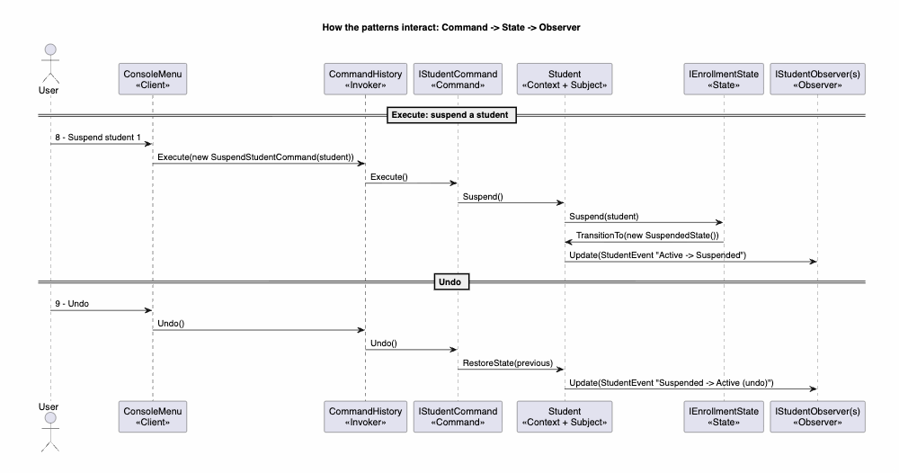
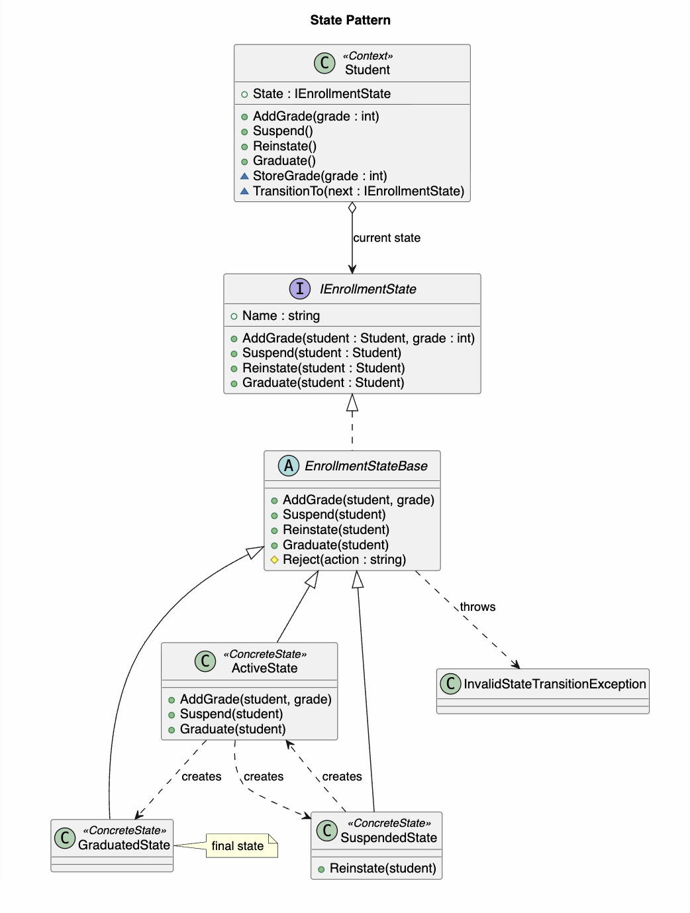
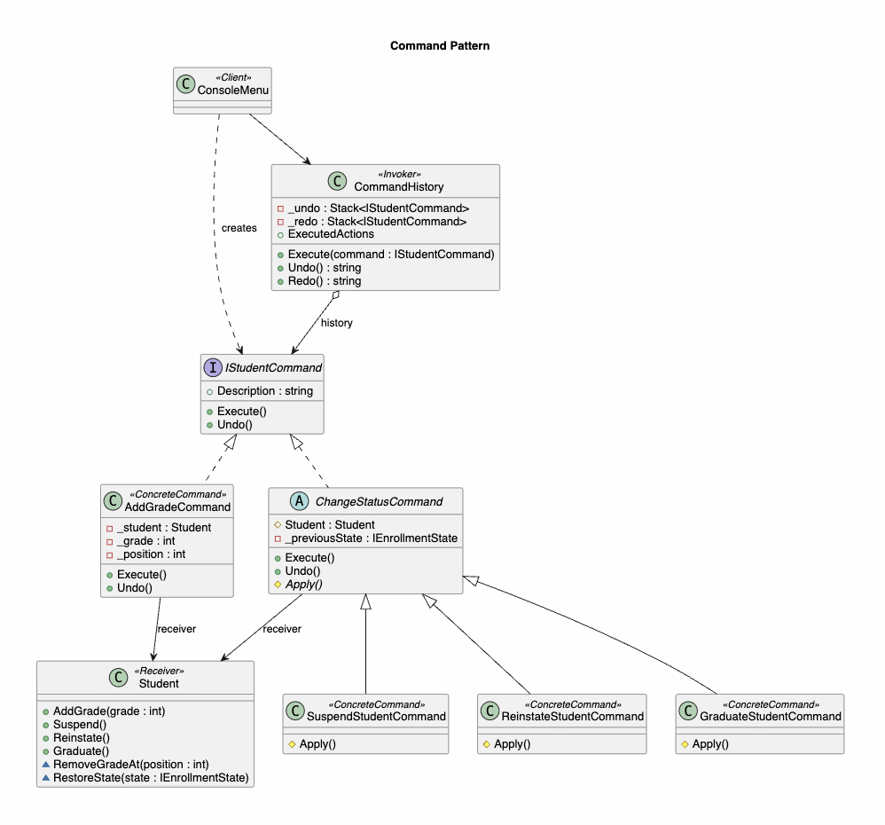
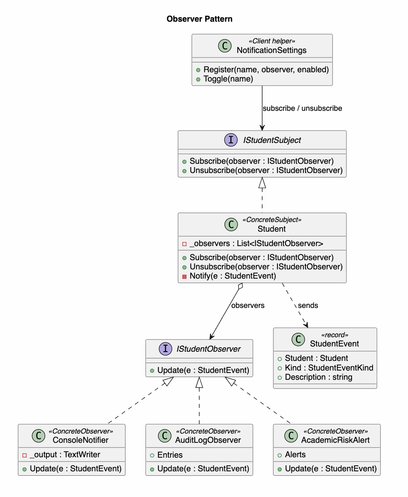

# Laboratory Work No. 3 — Behavioral Design Patterns

## 1. Domain description

The application is a console **Student Grade Management System** built in C# for Lab 1 and Lab 2.
A registry (Singleton) stores students created with a Builder; academic reports are produced by a
Factory Method, optionally decorated (Decorator), checked by a Proxy and coordinated by a Facade.

Lab 3 adds the life cycle of a student. A student can be **Active**, **Suspended** or **Graduated**, and
what can be done with the student depends on that status (State). Every grade or status change is a
command that can be **undone and redone** (Command). Whenever a student changes, interested
components — a console notifier, an audit log and an academic-risk alert for the dean's office —
are **notified automatically**, and the user can switch them on or off while the program runs (Observer).

### How the patterns interact



One user action passes through all three patterns: Command → State → Observer.
The client only works with `CommandHistory`, `IStudentCommand`, `IStudentObserver` and `IEnrollmentState`.
Lab 2 patterns are reused: students are created with `StudentBuilder`, stored in the `StudentRegistry`
Singleton, and reports are still generated through `AcademicReportFacade` for students in any state.

**Behavior changes at runtime (advanced A):** the user moves students between states (menu 8),
undoes/redoes actions (9, 10) and subscribes/unsubscribes observers (12) while the app runs.

---

## 2.1 State

**Problem it solves here.** Without State, every operation would need `if (status == Suspended) ... else if (status == Graduated) ...`
checks spread across the menu and `GradeManager`. With State, each status is a class that decides which actions are allowed and
which status comes next. Adding a new status (for example `OnAcademicLeave`) means adding one new class.


### Code snippet

[Domain/Student.cs](Domain/Student.cs) and [Behavioral/State/ActiveState.cs](Behavioral/State/ActiveState.cs)

```csharp
// Student (context): delegates to the current state
public IEnrollmentState State { get; private set; } = new ActiveState();

public void AddGrade(int grade)
{
    if (grade < 1 || grade > 10)
        throw new ArgumentOutOfRangeException(nameof(grade), "Grade must be between 1 and 10.");
    State.AddGrade(this, grade);
}
public void Suspend() => State.Suspend(this);
public void Reinstate() => State.Reinstate(this);
public void Graduate() => State.Graduate(this);

// ActiveState (concrete state): decides what happens and which state is next
public override void AddGrade(Student student, int grade) => student.StoreGrade(grade);
public override void Suspend(Student student) => student.TransitionTo(new SuspendedState());
public override void Graduate(Student student)
{
    double average = new GradeManager(new AverageCalculator()).GetResult(student);
    if (average < GradeManager.PassingAverage)
        throw new InvalidStateTransitionException($"Cannot graduate: average {average:F2} is below 5.00.");
    student.TransitionTo(new GraduatedState());
}
```

`Student` contains no `switch` on a status: it forwards each call to the current state object. The transitions live inside the
state classes (`ActiveState` creates `SuspendedState`, etc.), and `EnrollmentStateBase` rejects every action that a state does not override.

### Unit tests ([Tests/StatePatternTests.cs](Tests/StatePatternTests.cs))

| Test | What it checks |
|---|---|
| `State: valid transitions Active -> Suspended -> Active -> Graduated` | Allowed transitions change the state object. |
| `State: forbidden transitions are rejected and state is unchanged` | `Reinstate` on Active and `Suspend` on Graduated throw, and the state stays the same. |
| `State: same action behaves differently per state (AddGrade)` | Active stores the grade; Suspended rejects it and nothing is stored. |
| `State: graduation requires a passing average` | Graduating with average < 5 is rejected. |

### State pattern diagram



Transitions: `Active → Suspended` (suspend), `Suspended → Active` (reinstate), `Active → Graduated` (graduate, passing average required).


---

## 2.2 Command

**Problem it solves here.** Grade entry and status changes are mistakes waiting to happen (wrong grade, wrong student suspended).
Turning each action into an object lets `CommandHistory` keep a history and undo/redo it. Business rules stay in the receiver
(`Student` and its state); commands only remember what is needed to reverse the action.


### Code snippet

[Behavioral/Command/CommandHistory.cs](Behavioral/Command/CommandHistory.cs) and [Behavioral/Command/ChangeStatusCommand.cs](Behavioral/Command/ChangeStatusCommand.cs)

```csharp
// Invoker
public void Execute(IStudentCommand command)
{
    command.Execute();
    _undo.Push(command);
    _redo.Clear();
}

public string? Undo()
{
    if (!CanUndo) return null;
    IStudentCommand command = _undo.Pop();
    command.Undo();
    _redo.Push(command);
    return command.Description;
}

// Concrete command: execute / undo pair
public void Execute()
{
    IEnrollmentState before = Student.State;
    Apply();
    _previousState = before;
}
public void Undo()
{
    if (_previousState is null) return;
    Student.RestoreState(_previousState);
    _previousState = null;
}
```

`CommandHistory` only knows `IStudentCommand`, so a new action (for example `ChangeGroupCommand`) is just a new class.
Each command stores exactly what it needs to reverse itself (the previous state object, or the position of the added grade),
and a command that the state rejects throws before being pushed, so the history never contains failed actions.

### Unit tests ([Tests/CommandPatternTests.cs](Tests/CommandPatternTests.cs))

| Test | What it checks |
|---|---|
| `Command: execute then undo AddGrade restores original grades` | Grades after undo are exactly the original list. |
| `Command: undo of a status change restores the previous state` | Suspend + undo gives back `ActiveState`. |
| `Command: redo re-applies the undone command` | Graduate, undo, redo → Graduated again; redo stack is empty. |
| `Command: a rejected command is not recorded in history` | A grade rejected by `SuspendedState` is not added to the history. |

### Command pattern diagram




---

## 2.3 Observer

**Problem it solves here.** Several parts of the system care about changes to a student: the console, an audit log and the
dean's office risk alert. Without Observer, `Student` (or every menu option) would have to call each of them directly.
With Observer, `Student` only knows `IStudentObserver`; new listeners are added as new classes and can be (un)subscribed at runtime.


### Code snippet

[Domain/Student.cs](Domain/Student.cs)

```csharp
public void Subscribe(IStudentObserver observer)
{
    if (!_observers.Contains(observer)) _observers.Add(observer);
}

public void Unsubscribe(IStudentObserver observer) => _observers.Remove(observer);

private void Notify(StudentEvent studentEvent)
{
    foreach (IStudentObserver observer in _observers.ToList())
        observer.Update(studentEvent);
}

internal void TransitionTo(IEnrollmentState next)
{
    string previous = State.Name;
    State = next;
    Notify(new StudentEvent(this, StudentEventKind.StateChanged, $"status {previous} -> {next.Name}"));
}
```

The subject keeps a list of `IStudentObserver` and loops over it after every change; it never references a concrete observer.
Observers only read the student, so a notification cannot trigger another change and cause an update loop.

### Unit tests ([Tests/ObserverPatternTests.cs](Tests/ObserverPatternTests.cs))

| Test | What it checks |
|---|---|
| `Observer: all subscribed observers are notified` | Two subscribers each receive one `GradeAdded` event. |
| `Observer: unsubscribed observer is not notified` | After `Unsubscribe`, the observer receives nothing. |
| `Observer: academic risk alert reacts only when average < 5` | The alert fires only when the average drops below 5. |
| `Interaction: Command -> State -> Observer (execute and undo both notify)` | Executing and undoing a suspension both reach the audit log. |

### Observer pattern diagram



---

## 2.4 Test run

Command: `dotnet run -- --test`

```
--- Lab 2: structural patterns ---
PASS: Decorator: header adds information
PASS: Decorator: two wrappers work in either order
PASS: Proxy: blocks students without grades
PASS: Proxy: returns unchanged report for valid students
PASS: Facade: generates a decorated report
PASS: Facade: refuses unknown student ID

--- Lab 3: State ---
PASS: State: valid transitions Active -> Suspended -> Active -> Graduated
PASS: State: forbidden transitions are rejected and state is unchanged
PASS: State: same action behaves differently per state (AddGrade)
PASS: State: graduation requires a passing average

--- Lab 3: Command ---
PASS: Command: execute then undo AddGrade restores original grades
PASS: Command: undo of a status change restores the previous state
PASS: Command: redo re-applies the undone command
PASS: Command: a rejected command is not recorded in history

--- Lab 3: Observer ---
PASS: Observer: all subscribed observers are notified
PASS: Observer: unsubscribed observer is not notified
PASS: Observer: academic risk alert reacts only when average < 5
PASS: Interaction: Command -> State -> Observer (execute and undo both notify)

Tests: 18 passed, 0 failed.
```

## 2.5 Demo output (excerpt, `dotnet run -- --demo`)

```
=== 3. STATE: suspend, then try actions the Suspended state forbids ===
> Suspend Maria Ciobanu
  [Notification] Maria Ciobanu: status Active -> Suspended
> Add grade 10 to Maria Ciobanu
  Rejected: Cannot add a grade: student is Suspended.
> Graduate Maria Ciobanu
  Rejected: Cannot graduate: student is Suspended.
  Status: Suspended | Grades: 4, 9

=== 4. COMMAND + STATE: undo the suspension restores the Active state ===
  [Notification] Maria Ciobanu: status Suspended -> Active (undo)
Undone: Suspend Maria Ciobanu
  Status: Active | Grades: 4, 9
```

---

## 3. Conclusions

This laboratory work showed how behavioral design patterns improve the structure and flexibility of the Student Grade Management System. The State pattern made it possible to model the student's enrollment life cycle and enforce different rules for active, suspended, and graduated students. The Command pattern provided undo and redo functionality for grade and status changes while keeping the operation history separated from the business logic. The Observer pattern allowed multiple components to react to student changes without the `Student` class depending directly on their concrete implementations.

Implementing undo for state changes was one of the main difficulties, because it was not always possible to return to the previous state by executing the opposite action. For that reason, the command saves the previous state object and restores it when undo is called. It was also important to keep the rules in the state classes rather than in the commands or the menu. In addition, grades now have to be encapsulated as an `IReadOnlyList<int>` so that they can only be changed through the allowed state operations.

In a larger application, observers could be managed through a central event bus or Mediator instead of being attached to each student separately. The system could also be designed to support new actions without changing `IEnrollmentState`, but that would require additional abstraction and complexity. In the future, moving the tests to a separate xUnit project would make them easier to run and maintain with `dotnet test`.
